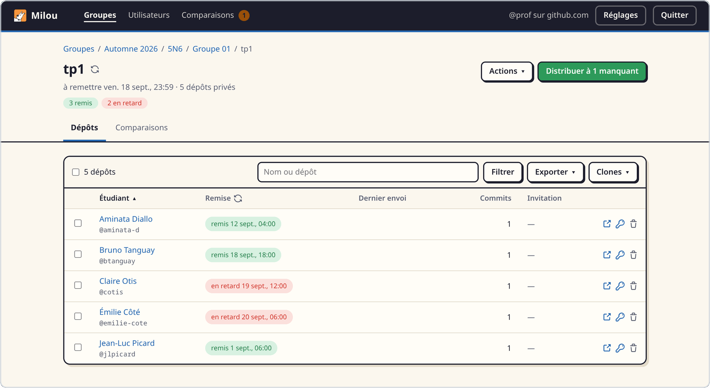
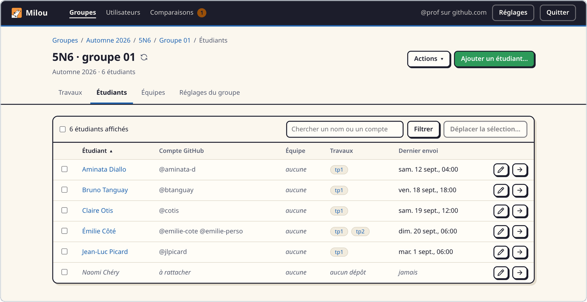
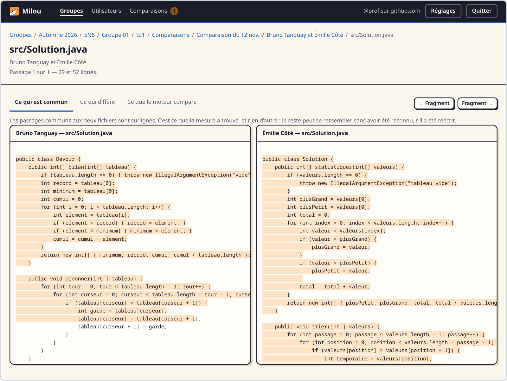

<p align="center">
  
</p>

<h1 align="center">Milou</h1>

<p align="center">
  <strong>Un dépôt GitHub par personne, rapporté au pas de course</strong>
</p>

<p align="center">
  L'extension du <a href="https://cli.github.com">GitHub CLI</a> pour enseigner avec GitHub :<br>
  un dépôt privé par étudiant, de la distribution à la remise.
</p>

<p align="center">
  <a href="https://github.com/PierreOlivierBrillant/gh-milou/actions/workflows/tests.yml"></a>
  <a href="https://github.com/PierreOlivierBrillant/gh-milou/releases/latest"></a>
  
</p>

<p align="center">
  <a href="#installation">Installation</a> ·
  <a href="#prise-en-main">Prise en main</a> ·
  <a href="#ce-que-fait-milou">Fonctionnalités</a> ·
  <a href="#des-noms-qui-se-lisent">Nommage</a> ·
  <a href="#fiabilité-et-sécurité">Sécurité</a>
</p>

<picture>
  <source media="(prefers-color-scheme: dark)" srcset="docs/captures/travail-sombre.png">
  <source media="(prefers-color-scheme: light)" srcset="docs/captures/travail-clair.png">
  
</picture>

## Pourquoi Milou

Vous enseignez la programmation, et vos étudiants travaillent sur GitHub. À
chaque travail, il faut un dépôt par personne, le code de départ dedans et une
invitation pour chacun ; à l'échéance, savoir qui a remis, récupérer les copies
— et parfois se demander pourquoi deux d'entre elles se ressemblent tant.

Milou s'en charge depuis votre poste, dans votre propre organisation GitHub. Pas
de serveur à installer ni d'application tierce à autoriser : il emprunte la
connexion du GitHub CLI, ne parle qu'à GitHub, et vous répond en français.

| Étape | Ce que fait Milou |
| --- | --- |
| **Inscrire** | Votre liste de classe devient un groupe : un CSV « nom complet, compte GitHub », ou la liste d'Omnivox telle quelle. |
| **Distribuer** | Un dépôt privé par étudiant, ou par équipe, garni du code de départ, et une invitation pour chacun. |
| **Suivre** | L'historique de chaque dépôt dit qui a remis, quand, et qui a dépassé la date cible. |
| **Récupérer** | Tous les dépôts clonés en parallèle, mis à jour d'un geste, exportés en CSV. |
| **Comparer** | Les copies mesurées deux à deux, même maquillées, et leurs passages communs côte à côte. |

C'est le modèle de GitHub Classroom, avec deux différences assumées : pas de
lien d'invitation à faire circuler — les dépôts sont créés directement —, et pas
de correction automatique.

## Installation

```bash
gh extension install PierreOlivierBrillant/gh-milou
```

Milou est distribué précompilé pour Linux, macOS et Windows : il suffit du
[GitHub CLI](https://cli.github.com), connecté à votre compte (`gh auth login`).
Pour le mettre à jour : `gh extension upgrade milou`.

<details>
<summary>Portées du jeton, droits requis, et migration depuis <code>gh cohorte</code></summary>

- **Portées** : `repo` pour créer les dépôts et inviter les étudiants, `read:org`
  pour lister vos organisations. À la demande : `admin:org` pour les travaux
  d'équipe, `delete_repo` pour supprimer un dépôt, `workflow` pour déposer des
  fichiers dans `.github/workflows`
  (`gh auth refresh -s admin:org,delete_repo,workflow`).
- **Droits** : il faut pouvoir créer des dépôts dans l'organisation visée ; un rôle
  insuffisant est signalé avant toute tentative.
- **`git`** ne sert qu'à cloner et à mettre à jour des clones.
- **Ancien nom** : l'outil s'appelait `gh cohorte`. Remplacez-le —
  `gh extension remove cohorte`, puis l'installation ci-dessus — : réglages,
  groupes déclarés et cache sont repris tels quels.

</details>

## Prise en main

```bash
gh milou
```

L'interface s'ouvre dans votre navigateur. Choisissez une organisation, créez un
groupe à partir de votre liste de classe, puis distribuez un premier travail :
Milou montre chaque dépôt qu'il va créer, et n'écrit rien avant votre
confirmation. Tout se range ensuite sur quatre niveaux, chacun avec son adresse
— un lien ou un rechargement ramène au même endroit :

```
session  →  cours  →  groupe  →  travail
a26         5N6        01        tp1
```

Les mêmes gestes existent au terminal, en assistant ou en drapeaux :

```bash
gh milou --cli                            # l'assistant, question par question
gh milou --roster cohorte.csv --dry-run   # voir ce qui serait fait, sans rien créer
gh milou --org acme --assignment tp1 --roster cohorte.csv --non-interactive --yes
```

## Ce que fait Milou

### Votre liste de classe, telle quelle

Deux colonnes suffisent : le nom complet et le compte GitHub
([exemple](examples/cohorte.csv)). Les en-têtes sont reconnus en français comme
en anglais, le séparateur est détecté, et une ligne fautive est signalée avec
son numéro sans arrêter la lecture du reste.

**La liste d'Omnivox se lit sans conversion** : son encodage, ses champs `="…"`,
ses colonnes « Nom » et « Prénom ». Elle ne dit pas les comptes GitHub, et ce
n'est pas un obstacle : chacun est inscrit sous son matricule, son dépôt porte
son nom, et le bilan dit qu'il reste un compte à rattacher.

<picture>
  <source media="(prefers-color-scheme: dark)" srcset="docs/captures/etudiants-sombre.png">
  <source media="(prefers-color-scheme: light)" srcset="docs/captures/etudiants-clair.png">
  
</picture>

<details>
<summary>Exporter la liste depuis Léa</summary>

*Liste des étudiants › Paramètres d'affichage*, mode « Pour Excel », séparateur
`;`, et cochez **Numéro d'étudiant**, **Nom de l'étudiant** et **Code
permanent**. Si vous connaissez les comptes GitHub, ajoutez-leur une colonne
`GitHub` ; sinon, [reprendre des dépôts existants](#reprendre-github-classroom)
rapproche les comptes des noms et des matricules, et montre chaque
rapprochement — avec ce qui l'a produit — avant d'écrire.

</details>

### Distribuer en un geste

Partez d'un **dépôt modèle** (`--template`) ou d'un **dossier de départ**
(`--starter`, par exemple [`examples/depart/`](examples/depart)) : Milou crée
les dépôts, y dépose le code en un seul commit par l'API Git, sans clone local,
et invite chacun dans le sien. Un dépôt déjà garni n'est jamais réécrit ; un
dépôt resté vide est complété à la relance. Un travail d'équipe donne un dépôt
par équipe, partagé avec une vraie équipe GitHub : changer sa composition suffit
à changer qui y accède.

### Suivre les remises

Fixez une date cible : Milou relève l'historique de chaque dépôt et dit qui a
remis, quand, et qui l'a fait en retard. Les listes se filtrent et se trient de
la même façon partout (`--filter`, `--pushed-after`, `--never-pushed`,
`--sort`…), se clonent en parallèle (`--jobs`) ou s'exportent en CSV.

### Comparer les copies, sans conclure à votre place

`--plagiarism` mesure les copies d'un travail deux à deux et les classe par
ordre de suspicion ; le code de départ distribué en est retiré d'office.
Renommer les variables et refaire la mise en page ne suffit pas à tromper la
mesure, et l'interface web montre les passages communs côte à côte. La
comparaison s'étend au cours, ou à toutes les sessions, anciens sigles compris
(`--reach`).

<picture>
  <source media="(prefers-color-scheme: dark)" srcset="docs/captures/comparaison-sombre.png">
  <source media="(prefers-color-scheme: light)" srcset="docs/captures/comparaison-clair.png">
  
</picture>

> [!IMPORTANT]
> **Ce n'est pas un détecteur de plagiat.** Une ressemblance forte n'est pas une
> preuve : elle se vérifie en lisant les passages communs, et elle s'explique
> parfois. Milou le redit sur chaque écran, et ce n'est pas une formule de
> politesse.

Chaque dépôt distribué porte aussi une **marque invisible** propre à son
destinataire, écrite en espaces et en tabulations dans son README : deux travaux
qui portent la même n'ont pas d'explication innocente, mais son absence ne
prouve rien. Elle se désactive dans les réglages, ou par `--no-sign`.

### Reprendre GitHub Classroom

Des dépôts nommés `travail-compte`, comme GitHub Classroom les laisse, se
reprennent d'un bloc : Milou repère les travaux, rapproche les comptes de votre
liste, puis renomme vers [sa nomenclature](#des-noms-qui-se-lisent). GitHub
garde une redirection depuis chaque ancien nom. Pour un travail d'équipe, rien
n'est à rapprocher : les membres viennent des accès au dépôt.

```bash
gh milou --import                                      # lister les travaux repérés
gh milou --import tp1 --into a26.5n6.1030 --roster liste.csv --dry-run
gh milou --import projet --teams --into a26.5n6.1030   # travail d'équipe
```

### Enseigner à plusieurs

Un **registre** privé dans l'organisation garde le nom de chaque compte et la
date de remise de chaque travail : vos collègues voient les mêmes noms que vous,
sans rien avoir déclaré. Chacun peut aussi ne voir que ses propres étudiants,
et comparer ses copies avec celles d'un collègue ne demande pas de lever ce
cloisonnement.

<details>
<summary>Le registre, le cloisonnement et l'échange entre collègues</summary>

- **Le registre** est le dépôt privé `.cohorte` de l'organisation : pour chaque
  compte, un nom complet et un rôle — étudiant ou enseignant —, écrits une fois
  pour tout le monde. Corriger une orthographe ne détache pas les dépôts créés
  sous l'ancienne. Il porte aussi les dates de remise et les équivalences de
  cours (« 5N6 est devenu 5M6 »). `gh milou --publish-registry` y verse les noms
  accumulés sur un poste ; le fichier local ne garde que ce qui n'a de sens que
  sur cette machine.
- **Le cloisonnement** : un groupe peut porter une équipe
  `a26.5n6.01.enseignants`, qui reçoit ses dépôts ; ceux qui n'en sont pas ne les
  voient pas. Le registre dit *qui* enseigne, l'équipe dit *où*, et seule l'équipe
  ouvre un accès. Pour que le cloisonnement tienne, les enseignants doivent être
  membres de l'organisation et non propriétaires, et sa permission de base doit
  être `none`.
- **Comparer sans rien lire** : ce qui circule est un index d'empreintes
  (`--publish-index`, `--against`), des hachés de fragments sous des jetons tirés
  au hasard, dans un second dépôt privé, `.cohorte-empreintes`. On mesure les
  ressemblances avec les copies d'en face sans en lire une ligne ni savoir de qui
  elles sont ; un catalogue dit qui a donné quel travail, à combien de personnes.
- **Lever le voile** demande une demande nommée (`--ask`), que le propriétaire des
  copies accorde ou refuse (`--grant`, `--deny`). S'il accorde, Milou lui prépare
  l'archive anonymisée de la seule copie demandée, et c'est lui qui l'envoie.
- **Avec une autre organisation**, ce sont des copies anonymisées qui
  s'échangent (`--export-zip`, `--import-zip`) : noms, comptes et matricules y
  deviennent des jetons de même longueur, et la table de correspondance reste chez
  l'expéditeur. L'anonymisation n'est jamais complète : ce qui lui a résisté est
  montré avant que l'archive ne parte.

</details>

## Des noms qui se lisent

Un dépôt porte **cinq niveaux, séparés par un point** :

```
session . cours . groupe . travail . étudiant
a26.5n6.01.tp1.emilie-cote
```

- **Le dernier niveau nomme le destinataire** : l'étudiant par son nom, pas par
  son compte GitHub, si bien qu'un dépôt se lit sans connaître le pseudonyme de
  personne. Pour un travail d'équipe, c'est l'équipe (`a26.5n6.01.projet.eq1`),
  dont le nom porte aussi la place du groupe (`a26.5n6.01.eq1`) : deux groupes
  peuvent ainsi avoir chacun leur « eq1 ».
- **Le point est réservé à cette découpe** : tout autre caractère devient un
  tiret (« J.-P. Tremblay » donne `j-p-tremblay`), et un nom se relit sans rien
  deviner.
- **GitHub reste la seule source de vérité** : un groupe n'a rien à déclarer pour
  exister, il se lit dans le nom de ses dépôts. Déplacer un groupe, un travail ou
  un étudiant, c'est renommer ses dépôts, avec un aperçu avant écriture ; les
  liens déjà distribués continuent de fonctionner.
- **Le matricule, et lui seul, identifie quelqu'un** : deux homonymes font
  échouer la préparation avant toute écriture, à moins que le matricule ne dise
  qu'il s'agit de la même personne sous deux comptes.

## Trois façons de s'en servir

L'interface web, l'assistant au terminal et la ligne de commande reposent sur le
même code : ce que l'une sait faire, les autres le savent aussi. Quelques gestes
restent pourtant propres au navigateur, faute d'équivalent au terminal.

| Geste | Web | Assistant | Ligne de commande |
| --- | :-: | :-: | :-: |
| Déclarer un groupe, tenir sa liste, déplacer une personne | ✓ | lecture seule | lecture seule |
| Renommer ou déplacer un groupe entier | ✓ | — | — |
| Retenir les réglages par défaut d'un groupe | ✓ | — | pour un lancement |
| Lire deux copies, puis deux fichiers, côte à côte | ✓ | — | — |
| Écrire les règles de comparaison | ✓ | — | fichier `--rules` |
| Publier les index de toute l'organisation | ✓ | le travail géré | `--publish-index` seul |

Au terminal, on travaille par préfixe (`--manage tp1`) : les groupes s'y lisent,
avec leurs listes et leurs dates cibles, sans s'y tenir, et les équipes d'un
groupe s'y gèrent par sa place (`--manage a26.5n6.01 --teams`). Tout le reste
est disponible partout, et `gh milou --help` donne chaque drapeau.

## Fiabilité et sécurité

- **Rien n'est écrit sans récapitulatif ni confirmation.** Comptes,
  organisation, noms de dépôts, collisions, dépôt modèle et dossier de départ
  sont vérifiés d'avance.
- **Relancer ne coûte rien.** Un dépôt existant est signalé « déjà présent »,
  jamais recréé ni écrasé, et la même commande reprend là où le lot s'était
  arrêté. Une erreur sur une personne n'arrête pas les autres ; chaque exécution
  dépose un bilan JSON et CSV dans `rapports/`.
- **Le jeton ne quitte pas `gh`.** Il n'est jamais affiché, journalisé ni écrit
  sur le disque, pas même dans un clone : `git` s'authentifie par
  `gh auth git-credential`, et met à jour par `git pull --ff-only`, sans toucher
  à un dossier où vous avez travaillé.
- **L'interface web ne répond qu'à vous.** Elle n'écoute que sur `127.0.0.1`,
  sur un port tiré au hasard, et n'accepte que les requêtes portant un jeton de
  session : un autre site ouvert dans le même navigateur ne peut rien déclencher.
- **Supprimer exige d'écrire le nom exact du dépôt**, et aucune option, `--yes`
  compris, ne court-circuite cette confirmation.
- **Les données d'étudiants restent privées.** Bilans, listes et clones sont
  exclus du dépôt par le `.gitignore`, et Milou refuse d'écrire dans un registre
  devenu public.

<details>
<summary>Codes de retour, variables d'environnement et cache</summary>

- **Codes de retour** : `0` succès, `1` au moins un échec, `2` erreur de
  validation, `130` interruption.
- **Variables** : `NO_COLOR` retire la couleur, `MILOU_NO_ARROWS` force les
  listes numérotées, `MILOU_NO_SHELL_COMPLETION` complète les chemins sans
  interroger le shell.
- **Cache** : les inventaires d'organisation sont gardés dans le répertoire du
  système (`~/.cache/milou/cache.json` sous Linux, permissions `600`) ;
  `--no-cache` s'en passe et `--clear-cache` le vide.

</details>

## Développement

```bash
go build .               # produit ./gh-milou
go test ./...            # toute la suite, sans aucun accès réseau
gh extension install .   # installer la version locale
go run ./cmd/apercu      # l'interface sur un faux GitHub, celle des captures
```

Les tests montent un faux serveur GitHub (`internal/fakegh`) et de vrais dépôts
git locaux (`file://`) : rien ne sort de la machine. La logique vit dans les
paquets du domaine (`internal/naming`, `internal/classroom`, `internal/plan`…),
dont les interfaces (`internal/web`, `internal/app`) ne sont que des façades :
c'est ce qui les empêche de diverger. [`CLAUDE.md`](CLAUDE.md) énonce les règles
à ne pas perdre de vue.

Pousser une étiquette `vX.Y.Z` déclenche le workflow
[`release`](.github/workflows/release.yml), qui construit Linux, macOS et
Windows, en amd64 comme en arm64.

---

<p align="center">
  <sub>Milou doit son nom au fox-terrier de Tintin : il court chercher chaque dépôt,<br>le rapporte, et ne perd personne en route.</sub>
</p>
